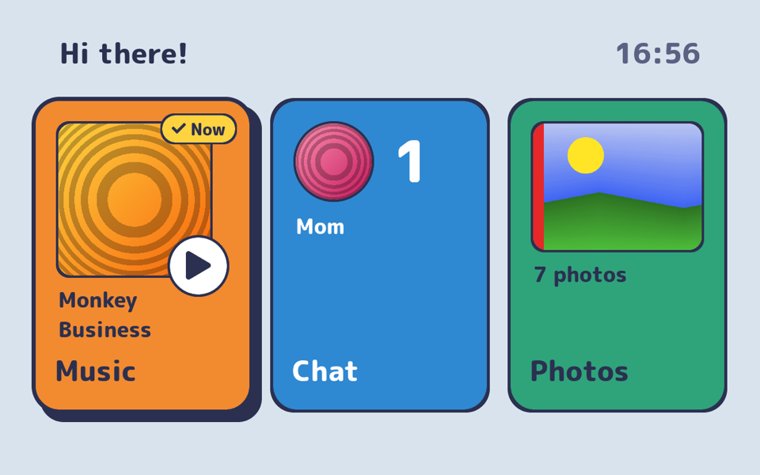
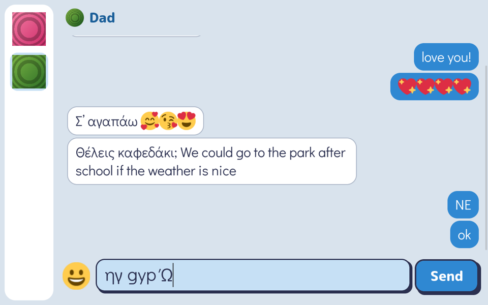
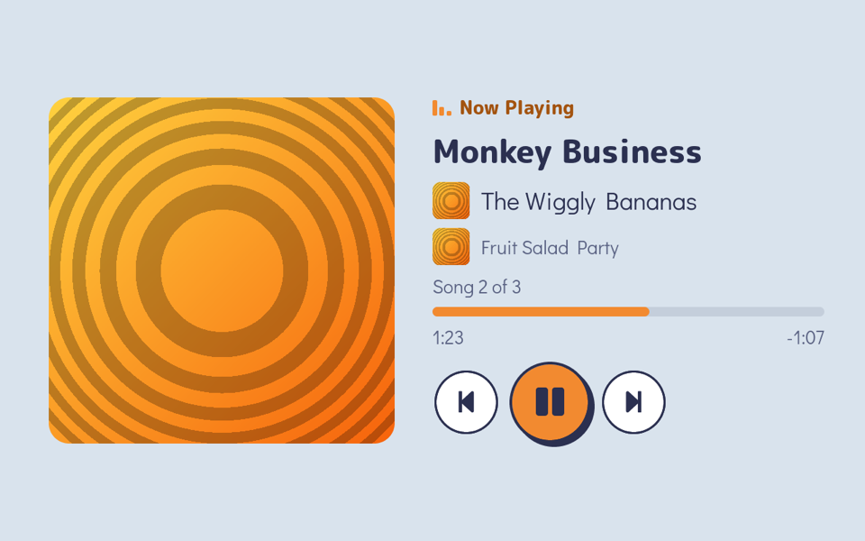
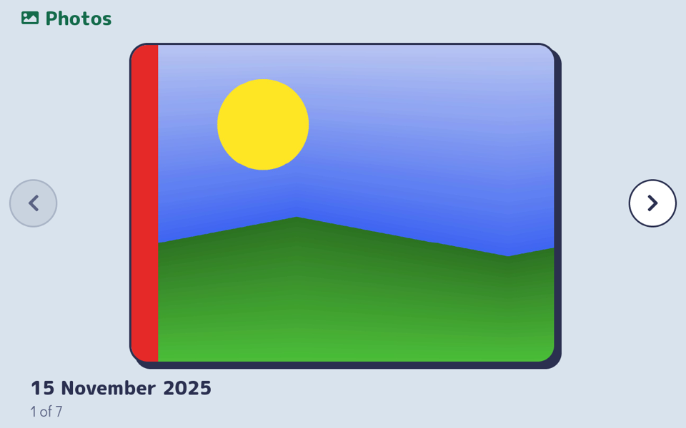

# Chatbox

**A messaging and music appliance for a 6-year-old.**

Chatbox is keyboard-only kiosk firmware, written in C with [LVGL](https://lvgl.io), that turns a Raspberry Pi (or an old Linux laptop) with a screen, a keyboard and a speaker into a child's own device. It boots straight into a fullscreen app with three parts:

- **Chat**: pick a family member and message them over [Matrix](https://matrix.org). The family uses any Matrix app (e.g. Element) on their phones; the child has text, a big emoji picker, and per-contact typing languages (Greek layout, French accents).
- **Music**: an iPod-style player. A grid of album covers, an album's songs, Now Playing; plays through [mpv](https://mpv.io) to a Bluetooth speaker. Parents add music by copying folders onto the device; a small indexer daemon picks them up.
- **Photos**: every photo the family sends in the chat is saved on the device and shown full screen.

No mouse, no touch, no browser, no app store, no settings in the child's UI. Pictures first, big type, every key answers.

| | |
|---|---|
|  |  |
|  |  |

<sub>Screenshots are rendered by the headless UI tests (`make test`) from test fixtures.</sub>

```
┌─────────────────────────────┐        HTTPS         ┌──────────────────────────────┐
│ Raspberry Pi (kiosk)        │◄────────────────────►│ Matrix homeserver            │
│  chatbox (LVGL, C, /dev/fb0)│  /_matrix/client/v3  │  reverse proxy (TLS)         │
│   chat · music · photos     │                      │   → Synapse (Docker)         │
│  chatbox-indexer + mpv      │                      │                              │
│  BT speaker, USB keyboard   │                      │ Matrix apps on family phones │
└─────────────────────────────┘                      └──────────────────────────────┘
```

## Features

- **Fullscreen, keyboard-only UI** on the Linux framebuffer (no X11/Wayland), 1280×800, with a light "sticker kit" look: one colour per app, big focus states, edges that bounce instead of dead ends ([docs/design.md](docs/design.md)).
- **App switcher** on Esc, with live tiles for Music, Chat and Photos.
- **Chat over Matrix**: up to 10 contacts, avatars, unread dots, optimistic sending with an outbox that retries forever, so a message typed offline is delivered later. Sync-only timelines, no end-to-end encryption.
- **Emoji**: a paged Twemoji picker on the Win key, emoji rendered inline in messages.
- **Typing languages** per contact: the Greek XKB layout, and `` ` `` + vowel accents (á, è, ά).
- **Music**: album grid, album page, Now Playing with a volume overlay; a parent-set volume cap; the indexer watches the music folder with inotify and reads tags and art with ffprobe/ffmpeg into SQLite.
- **Photos**: `m.image` messages are downloaded (authenticated media), saved atomically, decoded at display size (no 12 MP decode on a Pi), shown in a grid and a viewer; the child can delete them.
- **Display sleep**: a lock overlay after a minute idle, display off later; the waking key is swallowed.
- **Runs as one unprivileged system user** under systemd; logs to one file.
- **Tested**: unit tests for the config parser, the async Matrix dispatcher, the sync merge, the player (against a fake mpv), the indexer, the library and photos, and headless UI/keyboard tests that also write screenshots; an end-to-end test against a mock Matrix server in Docker.

## Using it

| Key | Chat | Music | Photos |
|---|---|---|---|
| **Esc** | close the emoji panel; otherwise open the switcher | one step back (Now Playing → album → grid); on the grid open the switcher | close the viewer (or the delete question); on the grid open the switcher |
| **Tab / arrows** | Tab: the next contact | arrows: move through the album grid / an album's songs | arrows: move through the grid; ← → in the viewer: previous / next photo |
| **Enter** | send the message | open an album; on a song: play, and open Now Playing | open the photo; on the delete question: delete |
| **Delete** | deletes the character after the cursor | | delete the photo (asks first) |
| **Win** | open/close the emoji panel | Now Playing ⇄ the album grid | |
| **PgUp / PgDn** | emoji page (panel open) | volume | |
| **Space** | types a space | pause / resume | |

The full key contract is in [docs/player-spec.md](docs/player-spec.md) §8 (Photos: [docs/photos.md](docs/photos.md)).

## Quick start

```bash
git clone --recursive <repo-url> chatbox && cd chatbox

# Desktop (SDL2 window), macOS or Linux
make build && make run

# Tests
make test                       # headless UI/keyboard tests
docker-compose run test         # every unit test + e2e against the mock Matrix server
```

Dependencies and every build target (Raspberry Pi framebuffer, other Linux machines, desktop SDL2, Docker): [docs/building.md](docs/building.md).

## Setting up a kiosk

1. **A homeserver.** Synapse in Docker with registration off, a `kiosk` account and one account per family member, behind a TLS reverse proxy: [docs/homeserver.md](docs/homeserver.md) (`homeserver/setup-synapse.sh`).
2. **Rooms.** One room between the kiosk and each family member: `homeserver/setup-matrix-rooms.sh` prints the `[contacts]` lines.
3. **The Pi.** Raspberry Pi OS Lite, a 1280×800 HDMI screen, a USB keyboard, optionally a Bluetooth speaker. Run `deploy/setup-pi-system.sh` on it once, fill in `/etc/chatbox.conf` ([docs/configuration.md](docs/configuration.md)), then from your dev machine, with `PI_HOST` and `PI_USER` in `.env` (see `.env.example`):
   ```bash
   make deploy                   # rsync to the Pi, build there, install, restart the services
   ```
   Details: [docs/pi.md](docs/pi.md).
4. **Music and photos.** Copy albums into `/srv/music` ([docs/music.md](docs/music.md)); photos arrive through the chat ([docs/photos.md](docs/photos.md)).

## Troubleshooting

| Symptom | First check |
|---|---|
| Digits / `!@#` do nothing, letters work | The keyboard's Fn lock ([docs/keyboard.md](docs/keyboard.md)) |
| Messages don't send or arrive | `sudo grep -E 'SSL\|send' /var/log/chatbox.err` on the Pi. An SSL error is a certificate problem on the homeserver ([docs/homeserver.md](docs/homeserver.md#troubleshooting)); `retrying` lines mean the outbox is holding the message |
| Kiosk not running | `systemctl status chatbox` and `/var/log/chatbox.err` ([docs/pi.md](docs/pi.md#troubleshooting)) |
| "No music yet", or no sound | [docs/music.md](docs/music.md#troubleshooting) |
| A chat photo doesn't show, or isn't in Photos | [docs/photos.md](docs/photos.md#troubleshooting) |
| Keys mapped in the LVGL patch (Win, PgUp/PgDn, Esc) do nothing | stale LVGL patch: clean rebuild ([docs/development.md](docs/development.md#the-lvgl-patch)) |

## Docs

| Doc | What's in it |
|---|---|
| [docs/building.md](docs/building.md) | Dependencies and builds for every target |
| [docs/configuration.md](docs/configuration.md) | `/etc/chatbox.conf`: every key, contacts, avatars, typing languages |
| [docs/homeserver.md](docs/homeserver.md) | Synapse in Docker, TLS via a reverse proxy, accounts, rooms, access tokens |
| [docs/pi.md](docs/pi.md) | First-time Pi setup, what deploy does, logs, operations |
| [docs/music.md](docs/music.md) | Music on the Pi: services, adding music, the on-device checklist, troubleshooting |
| [docs/photos.md](docs/photos.md) | Photos: how chat photos are saved, the Photos app and its keys, memory, config |
| [docs/keyboard.md](docs/keyboard.md) | The tested keyboard, Fn lock, Win lock, Delete |
| [docs/development.md](docs/development.md) | Tests, the mock server, the LVGL patch, profiling |
| [docs/architecture.md](docs/architecture.md) | How the app is put together: shell, apps, async Matrix client, threading |
| [docs/player-spec.md](docs/player-spec.md) | Music player and app shell spec (UX, keys, architecture decisions) |
| [docs/design.md](docs/design.md) | How the look came about |

## Credits

- [LVGL](https://github.com/lvgl/lvgl) (MIT) and [cJSON](https://github.com/DaveGamble/cJSON) (MIT), as git submodules.
- Emoji: [Twemoji](https://github.com/jdecked/twemoji) graphics, © Twitter, Inc. and other contributors, licensed under [CC BY 4.0](https://creativecommons.org/licenses/by/4.0/); resized to 48×48 PNGs in `pi/src/assets/emoji/` ([deploy/download-twemoji.sh](deploy/download-twemoji.sh)).
- Fonts (bitmaps generated with [lv_font_conv](https://github.com/lvgl/lv_font_conv)): [Didact Gothic](https://fonts.google.com/specimen/Didact+Gothic) and [M PLUS Rounded 1c](https://fonts.google.com/specimen/M+PLUS+Rounded+1c), SIL Open Font License 1.1 (licences in `pi/fonts/`); [DejaVu Sans](https://dejavu-fonts.github.io) for a few glyphs (Bitstream Vera / DejaVu licence); [Font Awesome](https://fontawesome.com) Free icons (SIL OFL 1.1), from LVGL's bundled fonts.
